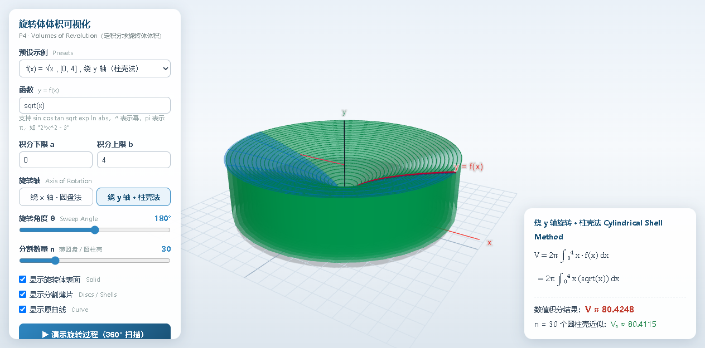

# 旋转体体积可视化 · Volumes of Revolution (P4)

一个面向 A Level 学生（Edexcel P4）的 3D 交互式教学软件：输入函数 y = f(x) 与积分区间 [a, b]，直观演示曲线绕 x 轴 / y 轴旋转形成旋转体的动态过程，并实时显示定积分公式与数值结果。



## 在线使用

直接访问 GitHub Pages 地址，或把整个文件夹拷到任意电脑**双击 `index.html` 离线打开**——应用完全自包含，无需联网。

## 功能

- **函数输入**：支持 `x^2`、`sqrt(x)`、`sin(x)`、`exp(x)`、`ln(x)`、`pi` 等，兼容隐式乘法（`2x` 自动识别为 `2*x`）；内置 7 个带验证答案的预设示例
- **两种旋转方式**：绕 x 轴（圆盘法 Disk Method）/ 绕 y 轴（柱壳法 Cylindrical Shell Method），一键切换
- **3D 动态演示**：旋转角度 θ（0–360°）滑块逐度"扫出"旋转体，附自动播放按钮
- **分割数量 n**（4–120）：实时观察薄圆盘 / 圆柱壳近似值 Vₙ 随 n 增大收敛到精确值
- **公式与数值**：实时显示定积分公式、Simpson 数值积分精确值、n 个薄片的近似值
- **视角**：拖拽旋转 / 滚轮缩放 / 右键平移，相机自动适配场景

## 预设示例与验证答案

| 函数 | 区间 | 旋转轴 | 精确体积 |
|---|---|---|---|
| f(x) = x² | [0, 1] | x 轴 | π/5 ≈ 0.6283 |
| f(x) = √x | [0, 4] | x 轴 | 8π ≈ 25.1327 |
| f(x) = sin x | [0, π] | x 轴 | π²/2 ≈ 4.9348 |
| f(x) = x² | [0, 2] | y 轴（柱壳） | 8π ≈ 25.1327 |

## 技术说明

- **零外部依赖**：Three.js r160 + OrbitControls 已合并为本地 `bundle.js`（无 CDN、无网络请求），规避了 CDN 不可达与 ES module 的 CORS 限制
- 纯静态、单页应用，兼容 Chrome / Edge / Firefox / Safari（需支持 WebGL2）
- 重新打包：安装 Node 后运行 `node build-bundle.js`，即可从 `libs/` 重新生成 `bundle.js`

## 部署到 GitHub Pages

```bash
git init
git add .
git commit -m "Volumes of Revolution 3D visualization"
git branch -M main
git remote add origin https://github.com/<你的用户名>/<仓库名>.git
git push -u origin main
```

然后在仓库 **Settings → Pages → Source** 选择 `Deploy from a branch` → `main` / `(root)`，保存后即可通过
`https://<你的用户名>.github.io/<仓库名>/` 长期访问。

## 文件结构

```
volume-of-revolution/
├── index.html          # 应用入口（含全部 UI 与逻辑）
├── bundle.js           # Three.js r160 + OrbitControls 本地合并包
├── libs/               # 合并前的原始库文件（重建用）
├── build-bundle.js     # 合并打包脚本
└── verify-screenshot*.png  # 浏览器实测截图
```
